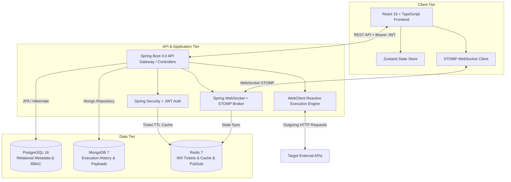
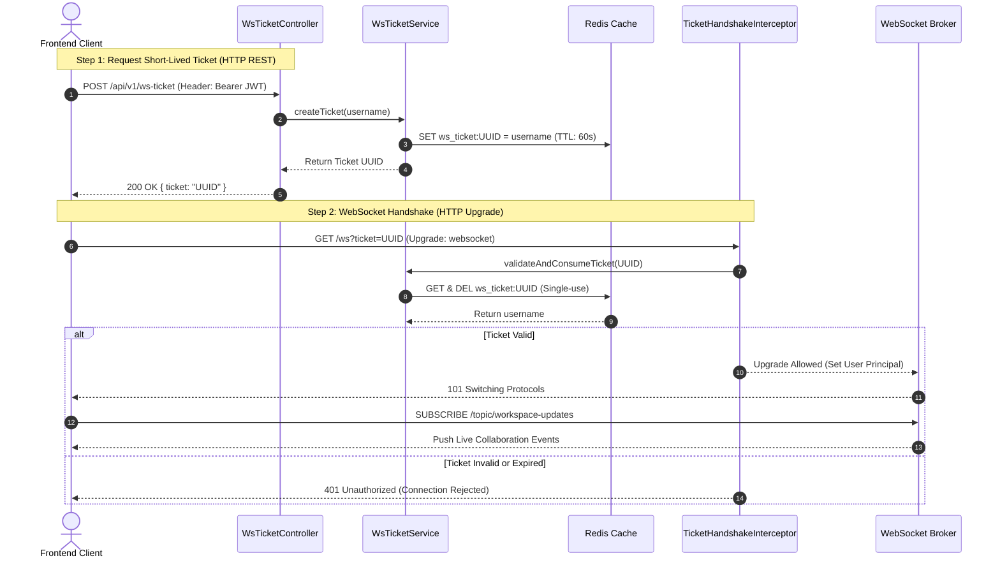

# PostKid 🚀

[](https://www.oracle.com/java/)
[](https://spring.io/projects/spring-boot)
[](https://react.dev/)
[](https://www.typescriptlang.org/)
[](https://vitejs.dev/)
[](https://tailwindcss.com/)
[](https://www.docker.com/)
[](LICENSE)

**PostKid** is an enterprise-grade, real-time API collaboration and testing platform designed for modern software engineering teams. Built with a high-performance Spring Boot backend and an ultra-responsive React 19 frontend, PostKid enables teams to design, test, execute, share, and document APIs seamlessly with real-time state synchronization, granular role-based access control (RBAC), and hybrid data persistence.

---

## 📋 Table of Contents

- [Key Features](#-key-features)
- [System Architecture](#-system-architecture)
- [Real-Time Collaboration & Security](#-real-time-collaboration--security)
- [Tech Stack](#-tech-stack)
- [Project Directory Structure](#-project-directory-structure)
- [Getting Started](#-getting-started)
  - [Prerequisites](#prerequisites)
  - [Option A: Quickstart with Docker Compose (Recommended)](#option-a-quickstart-with-docker-compose-recommended)
  - [Option B: Manual Local Development Setup](#option-b-manual-local-development-setup)
- [Environment Configuration](#-environment-configuration)
- [API Documentation & Health Monitoring](#-api-documentation--health-monitoring)
- [Testing & Quality Assurance](#-testing--quality-assurance)
- [Production Deployment](#-production-deployment)
- [License](#-license)

---

## ✨ Key Features

- ⚡ **High-Performance Reactive Request Engine**: Execute HTTP requests (GET, POST, PUT, DELETE, PATCH, OPTIONS, HEAD) with configurable timeouts, dynamic headers, query parameters, authentication payloads (Bearer, Basic Auth), and body types powered by Spring WebFlux (`WebClient`).
- 👥 **Real-Time Workspace Collaboration**: Broadcast collection updates, request executions, folder edits, and workspace changes instantly across connected team members via STOMP over WebSockets.
- 🔒 **Secure Single-Use WebSocket Authentication**: Zero token exposure over socket connection URLs using a Redis-backed short-lived ticket handshake (`POST /api/v1/ws-ticket` -> Redis 60s TTL token).
- 🔐 **Granular Role-Based Access Control (RBAC)**: Enforce security at workspace and collection levels with predefined user roles (`OWNER`, `ADMIN`, `MEMBER`, `VIEWER`).
- 📂 **Hierarchical Collection & Workspace Management**: Organize endpoints cleanly into nested folders, workspace environments, and shareable API collections with inherited headers and configurations.
- 🌐 **Dynamic Environment & Variable Interpolation**: Manage workspace variables across multiple environments (e.g., Development, Staging, Production) with dynamic `{{variable}}` substitution.
- 📜 **Full Execution History & Payload Auditing**: Track all executed requests, status codes, response headers, latency timings, and body payloads with persistent history auditing stored in MongoDB.
- 📊 **Enterprise Observability**: Built-in Spring Boot Actuator health checks, Micrometer Prometheus metrics integration, and automated OpenAPI 3.0 / Swagger UI documentation generation.

---

## 🏗 System Architecture

PostKid utilizes a decoupled hybrid persistence architecture tailored for enterprise scale, data integrity, and real-time responsiveness:

- **PostgreSQL**: Manages relational metadata, user accounts, workspace memberships, permissions, collections, folders, and request configurations.
- **MongoDB**: Handles unstructured request execution histories, response bodies, and audit log documents.
- **Redis**: Serves as a high-speed caching engine, session store, single-use ticket broker for WebSocket authentication, and Pub/Sub channel for multi-node event broadcasting.



---

## 🔒 Real-Time Collaboration & Security

PostKid implements a secure single-use ticket pattern for WebSockets, preventing JWT token leakage through WebSocket query strings or browser history logs:



---

## 🛠 Tech Stack

### Backend

| Component | Technology | Version | Description |
| :--- | :--- | :--- | :--- |
| **Language** | Java | 25 | Latest JDK standard |
| **Framework** | Spring Boot | 4.0.6 | Core backend application container |
| **Security** | Spring Security + JJWT | 0.13.0 | Stateless JWT authentication & authorization |
| **Web & Reactive** | Spring Web + WebFlux | 4.0.6 | Servlet API & WebClient reactive request execution engine |
| **Real-Time** | Spring WebSocket + STOMP | 4.0.6 | Dual-channel real-time socket communication |
| **Databases** | PostgreSQL / Spring Data JPA | 16 / 4.0.6 | Relational store for users, workspaces, permissions |
| **Document Store** | MongoDB / Spring Data MongoDB | 7 / 4.0.6 | NoSQL store for execution logs & heavy payloads |
| **Cache & Pub/Sub** | Redis / Spring Data Redis | 7 / 4.0.6 | Session caching & single-use WS tickets |
| **Documentation** | SpringDoc OpenAPI UI | 3.0.2 | Swagger UI interactive API documentation |
| **Observability** | Micrometer Prometheus | 4.0.6 | Prometheus metrics exposition |

### Frontend

| Component | Technology | Version | Description |
| :--- | :--- | :--- | :--- |
| **Framework** | React | 19.2.6 | Component UI framework |
| **Language** | TypeScript | 6.0.2 | Static typing and interfaces |
| **Build System** | Vite | 8.0.12 | Ultra-fast development server & bundler |
| **Styling** | Tailwind CSS | 4.3.0 | Utility-first CSS styling engine |
| **State Management** | Zustand | 5.0.13 | Lightweight global application state manager |
| **Server State** | TanStack React Query | 5.100.10 | Data fetching, caching, and invalidation |
| **HTTP Client** | Axios | 1.16.1 | REST API communication |
| **WebSocket** | STOMPjs + SockJS Client | 7.3.0 / 1.6.1 | WebSockets STOMP protocol integration |
| **Icons** | Lucide React | 1.16.0 | Modern UI icon library |

---

## 📁 Project Directory Structure

```text
PostKid/
├── backend/                         # Spring Boot Application (Java 25)
│   ├── src/main/java/com/apurv/
│   │   ├── auth/                    # Authentication, User entities, JWT filters
│   │   ├── collaboration/           # WS ticket generation, Handshake handlers, STOMP controllers
│   │   ├── collection/              # Collection and Folder CRUD controllers & services
│   │   ├── common/                  # Global Exception handlers, API response utilities
│   │   ├── config/                  # Security, Redis, Mongo, WebSocket & WebClient configs
│   │   ├── environment/             # Environment & dynamic variable management
│   │   ├── history/                 # Request execution auditing & Mongo repositories
│   │   ├── request/                 # WebClient HTTP request execution engine
│   │   └── workspace/               # Workspaces, RBAC roles, member invitations
│   ├── src/main/resources/
│   │   └── application.yaml         # Application configuration properties
│   ├── Dockerfile                   # Multi-stage Docker build file for backend
│   └── pom.xml                      # Maven project definition
├── frontend/                        # React 19 + TypeScript Frontend
│   ├── src/
│   │   ├── auth/                    # Auth state, login/register UI, token storage
│   │   ├── collaboration/           # WS store (Zustand), event handlers, connection logic
│   │   ├── collection/              # Collection explorer & folder tree components
│   │   ├── config/                  # Axios instance, baseURL configuration
│   │   ├── environment/             # Environment selector & key-value editor components
│   │   ├── history/                 # Execution history list & details view
│   │   ├── request/                 # Request builder tab, body editor, response view
│   │   └── workspace/               # Workspace picker & user access control management
│   ├── Dockerfile                   # Multi-stage Docker build file for frontend
│   ├── package.json                 # Frontend dependencies and npm scripts
│   └── vite.config.ts               # Vite bundler configuration
├── infrastructure/
│   └── docker-compose.yaml          # Orchestration manifest (Postgres, Mongo, Redis, App)
└── docs/                            # Deep-dive architecture and sequence documentation
```

---

## 🚀 Getting Started

### Prerequisites

Ensure you have the following installed on your machine:

- **Java Development Kit (JDK)**: Version 25 or higher
- **Node.js**: Version 20.x or higher & **npm** 10.x or higher
- **Docker** & **Docker Compose**: Latest stable version
- **Maven**: Version 3.9+ (or use the provided `./mvnw` wrapper)

---

### Option A: Quickstart with Docker Compose (Recommended)

To launch the complete infrastructure stack (PostgreSQL, MongoDB, Redis, Spring Boot Backend, and React Frontend) with a single command:

```bash
# Clone the repository
git clone https://github.com/your-username/PostKid.git
cd PostKid

# Launch all containers via Docker Compose
docker-compose -f infrastructure/docker-compose.yaml up --build -d
```

Once all containers report healthy status:

- 🌐 **Frontend UI**: [http://localhost:5173](http://localhost:5173)
- ⚙️ **Backend API**: [http://localhost:8080](http://localhost:8080)
- 📚 **Swagger UI**: [http://localhost:8080/swagger-ui.html](http://localhost:8080/swagger-ui.html)
- 🩺 **Actuator Health**: [http://localhost:8080/actuator/health](http://localhost:8080/actuator/health)

To stop the services:

```bash
docker-compose -f infrastructure/docker-compose.yaml down
```

---

### Option B: Manual Local Development Setup

#### 1. Start Infrastructure Services (Databases)

Launch PostgreSQL, Redis, and MongoDB using Docker:

```bash
docker run -d --name postkid-postgres -p 5432:5432 -e POSTGRES_USER=postgres -e POSTGRES_PASSWORD=postgres -e POSTGRES_DB=postKid postgres:16
docker run -d --name postkid-redis -p 6379:6379 redis:7
docker run -d --name postkid-mongodb -p 27017:27017 mongo:7
```

#### 2. Start Backend Application

```bash
cd backend

# Build and run using Maven wrapper
./mvnw clean spring-boot:run
```

*The backend server will start on port `8080`.*

#### 3. Start Frontend Application

```bash
cd frontend

# Install node dependencies
npm install

# Start Vite local development server
npm run dev
```

*The frontend development server will start on `http://localhost:5173`.*

---

## 🔧 Environment Configuration

### Backend Options (`backend/src/main/resources/application.yaml`)

| Environment Variable | Default Value | Description |
| :--- | :--- | :--- |
| `SERVER_PORT` | `8080` | Port on which the Spring Boot server listens |
| `DB_USERNAME` | `postgres` | PostgreSQL connection user |
| `DB_PASSWORD` | `postgres` | PostgreSQL connection password |
| `SPRING_DATASOURCE_URL` | `jdbc:postgresql://localhost:5432/postKid` | PostgreSQL JDBC connection URL |
| `REDIS_HOST` | `localhost` | Redis server hostname |
| `REDIS_PORT` | `6379` | Redis server port |
| `MONGODB_URI` | `mongodb://localhost:27017/postKid` | MongoDB connection URI |
| `JWT_SECRET` | *(64-char hex string)* | HMAC-SHA secret key for JWT signing |
| `JWT_EXPIRATION` | `86400000` | JWT Access Token expiration time (ms) [Default: 24h] |
| `JWT_REFRESH_EXPIRATION` | `604800000` | JWT Refresh Token expiration time (ms) [Default: 7 days] |
| `POSTKID_ALLOWED_URLS` | `http://localhost:5173` | CORS allowed origins |

---

## 📚 API Documentation & Health Monitoring

### Interactive OpenAPI Specs

- **Swagger UI Console**: `http://localhost:8080/swagger-ui.html`
- **OpenAPI JSON Spec**: `http://localhost:8080/api-docs`

### Key Endpoint Routes

```text
POST /api/v1/auth/register          # User registration
POST /api/v1/auth/login             # Authenticate & retrieve JWT access tokens
POST /api/v1/ws-ticket              # Generate short-lived WebSocket authentication ticket

GET  /api/v1/workspaces             # List user workspaces
POST /api/v1/workspaces             # Create new workspace
POST /api/v1/workspaces/{id}/members# Add member & assign RBAC role

GET  /api/v1/collections            # Fetch workspace collections
POST /api/v1/collections            # Create API collection

POST /api/v1/requests/execute       # Execute HTTP request via WebClient engine
GET  /api/v1/history                # Query request execution audit logs
```

### Metrics & Observability Endpoints

- **Health Check**: `GET /actuator/health`
- **Prometheus Metrics**: `GET /actuator/prometheus`
- **Application Info**: `GET /actuator/info`

---

## 🧪 Testing & Quality Assurance

### Running Backend Unit & Integration Tests

```bash
cd backend
./mvnw test
```

### Running Frontend Type-Checking & Linting

```bash
cd frontend
# Run TypeScript type check & Vite build verification
npm run build

# Run ESLint validation
npm run lint
```

---

## 🚢 Production Deployment

### Building Production Containers

Both frontend and backend include multi-stage Dockerfiles optimized for lightweight production distribution.

```bash
# Build Backend Container Image
docker build -t postkid-backend:latest ./backend

# Build Frontend Container Image
docker build -t postkid-frontend:latest ./frontend
```

---

## 📄 License

This project is licensed under the **MIT License**. See the [LICENSE](LICENSE) file for more details.

---

*Built with ❤️ for developer efficiency and seamless API collaboration.*
